# Component 2: Data Science - patterns, trends and relationships in the Bangkok CCTV dataset

Generated 2026-11-05 11:47 from `data/processed/Carcounts.csv (object detection only; air quality and weather not available) + camera-level POI features`.

The project brief defines this component as applying analytical methods to explore patterns, trends and insights in the prepared dataset, and defines the project objective as analysing meaningful spatial and/or temporal patterns. This report does both: sections 2, 8 and 9 are the temporal analysis, sections 5 and 7 the spatial analysis, sections 1, 3, 4 and 6 establish what the data can and cannot support, section 12 hands tidy tables to the dashboard, and section 13 is the set of insights Component 4 reports.

Section 10 is an extension rather than a requirement. The group's chosen angle is relating these counts to PM2.5, and that section runs automatically once the air-quality columns are present in the prepared file. Nothing earlier in the report depends on it.

## How the analysis is set up

The prepared file has one row per image, but almost nothing should be correlated at that level. Three levels are used, and every result below states which one it came from.

| level       |   rows | varies at this level                 |
|:------------|-------:|:-------------------------------------|
| image       | 61,319 | vehicle counts (plus detector noise) |
| camera-hour | 10,728 | PM2.5, weather, averaged traffic     |
| camera      |    100 | POI and road features, mean traffic  |

- Correlations use Spearman's rho: the counts are zero-inflated and right-skewed, so a Pearson coefficient would mostly measure the tail.
- Every coefficient is reported with a 95% confidence interval and the number of complete pairs behind it.
- Where many features are tested at once, p-values are Benjamini-Hochberg corrected to a false discovery rate of q = 0.05; the uncorrected p is kept in the tables.
- Intervals for camera-level quantities come from a bootstrap that resamples whole cameras, not rows.

## 1. What the prepared dataset contains

**Finding.** 61,319 images from 100 cameras over 7 days (2026-08-25 to 2026-08-31), sampled roughly every 10 minutes.

**Finding.** Coverage is daylight only, 06:00 to 21:00. Nothing in this analysis can speak to overnight behaviour, which is when Bangkok PM2.5 typically peaks.

**Finding.** The window contains 2 weekend days from one weekend, so the weekday/weekend contrast cannot be separated from whatever else was happening that particular weekend. Treat it as suggestive.

**Finding.** No duplicate images and no duplicate camera-timestamp pairs: the DE join did not fan out.

**Finding.** The detector output is strongly zero-inflated: bus_count is zero in 74% of frames. Treat the rarer classes as presence/absence rather than as counts, and prefer totals over single-class counts.

**Finding.** Sampling is not uniform across the day: 21:00 (354 images), against a median of 4,178 images per hour. Hourly means for those hours rest on far less data and should not be read as trend.

**Finding.** Missing values in the `poi_nearest_*` columns are meaningful, not broken: NaN means nothing of that kind lies within the 500 m search radius (poi_nearest_traffic_signals_m is NaN for 47% of rows). They must be modelled as censored at 500 m, never imputed with a mean. The same applies to `heavy_share` and `motorcycle_share`, which are undefined on empty frames rather than zero.

**Finding.** PM2.5 is absent from the prepared file, so no section below can test the project's actual hypothesis. Everything here characterises the predictors only.

*Detector output per vehicle class, image level.*

|                  |   mean |   median |   p95 |   max |   pct_zero |   share_of_traffic |
|:-----------------|-------:|---------:|------:|------:|-----------:|-------------------:|
| car_count        |   7.94 |        7 |    19 |    39 |       6.28 |              74.91 |
| motorcycle_count |   1.06 |        0 |     5 |    27 |      62.4  |               9.97 |
| bus_count        |   0.4  |        0 |     2 |    13 |      74.37 |               3.81 |
| truck_count      |   1.2  |        1 |     4 |    16 |      45.49 |              11.3  |

*Columns with any missing values (%).*

|                               |   pct_missing |
|:------------------------------|--------------:|
| poi_nearest_traffic_signals_m |      46.9593  |
| poi_nearest_green_m           |      13.9957  |
| heavy_share                   |       4.62662 |
| motorcycle_share              |       4.62662 |
| poi_nearest_bus_stop_m        |       1.02578 |

## 2. Temporal patterns

**Finding.** Traffic peaks at 17:00 and bottoms out at 20:00, a 2.16x swing in mean vehicles per frame. The daily cycle is real but shallow.

**Finding.** Hour of day alone explains only 11.5% of camera-hour variance in total vehicles. Time of day is a weak predictor here compared with which camera you are looking at (see the variance decomposition below).

**Finding.** Weekday traffic exceeds weekend traffic by 2.33 vehicles per frame [2.05, 2.64] on a camera-clustered bootstrap over 100 cameras.

**Finding.** That interval excludes zero, so the weekday/weekend difference survives clustering, unlike most row-level effects in this dataset.

**Finding.** The classes do not share a peak hour (motorcycle at 08:00, truck at 11:00, bus at 16:00, car at 17:00), a spread of 9 hours. They are different traffic processes and should not be collapsed into one 'congestion' number without checking which class drives a result.

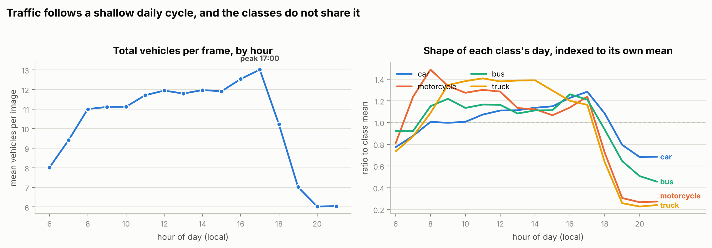

*Mean vehicles per frame by hour, and the shape of each class's day.*

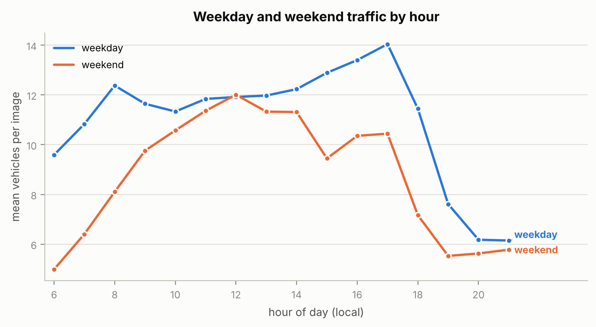

*Weekday and weekend hourly traffic profiles.*

*Mean counts per image by hour of day.*

|   hour |   car_count |   motorcycle_count |   bus_count |   truck_count |   total_vehicles |   n_images |
|-------:|------------:|-------------------:|------------:|--------------:|-----------------:|-----------:|
|      6 |       6     |              0.821 |       0.36  |         0.837 |            8.018 |       3486 |
|      7 |       6.804 |              1.256 |       0.36  |         0.995 |            9.415 |       3599 |
|      8 |       7.802 |              1.509 |       0.449 |         1.24  |           10.999 |       3703 |
|      9 |       7.741 |              1.357 |       0.476 |         1.533 |           11.107 |       4185 |
|     10 |       7.805 |              1.293 |       0.443 |         1.574 |           11.116 |       4182 |
|     11 |       8.326 |              1.32  |       0.455 |         1.603 |           11.704 |       4177 |
|     12 |       8.614 |              1.304 |       0.454 |         1.571 |           11.944 |       4175 |
|     13 |       8.637 |              1.15  |       0.423 |         1.58  |           11.79  |       4179 |
|     14 |       8.813 |              1.139 |       0.434 |         1.583 |           11.969 |       4187 |
|     15 |       8.915 |              1.083 |       0.435 |         1.475 |           11.908 |       4182 |
|     16 |       9.518 |              1.155 |       0.492 |         1.368 |           12.533 |       4176 |
|     17 |       9.957 |              1.258 |       0.473 |         1.325 |           13.013 |       4184 |
|     18 |       8.402 |              0.733 |       0.365 |         0.723 |           10.223 |       4173 |
|     19 |       6.163 |              0.31  |       0.252 |         0.294 |            7.019 |       4185 |
|     20 |       5.296 |              0.271 |       0.198 |         0.259 |            6.023 |       4192 |
|     21 |       5.316 |              0.277 |       0.178 |         0.274 |            6.045 |        354 |

*Mean total vehicles per image by date.*

| date       | day_name   |   mean |   count |
|:-----------|:-----------|-------:|--------:|
| 2026-08-25 | Tuesday    | 11.341 |    8937 |
| 2026-08-26 | Wednesday  | 11.687 |    8953 |
| 2026-08-27 | Thursday   | 11.217 |    7438 |
| 2026-08-28 | Friday     | 11.487 |    9015 |
| 2026-08-29 | Saturday   |  9.414 |    8964 |
| 2026-08-30 | Sunday     |  8.487 |    9002 |
| 2026-08-31 | Monday     | 10.647 |    9010 |

## 3. How the four detector channels relate

**Finding.** Mean off-diagonal correlation among the four channels is +0.21 per frame and +0.39 per camera, a factor of 1.8. Both are moderate; the point is the gap. Averaging over a camera removes per-frame detection noise, and what is left behind is the shared 'how busy is this place' component.

**Finding.** The first principal component takes 50% of the camera-level variance, against 25% for 4 structureless channels. There is a common volume factor, but it is not dominant: collapsing the classes into one index would discard about 50% of the variation, and PC2 (23%) is dominated by motorcycle. Keep the class breakdown; do not replace it with a single number.

**Finding.** Practical consequence for the PM2.5 model: aggregate to camera-hour before fitting. Feeding raw per-image counts in adds variance without adding signal.

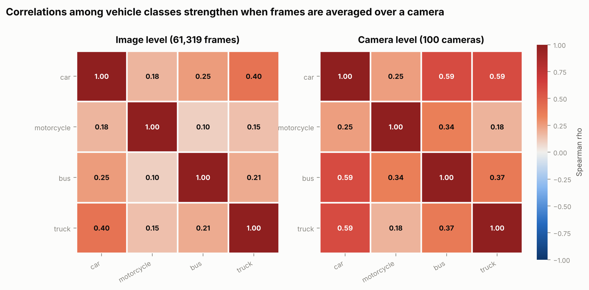

*Spearman correlations among vehicle classes at image and camera level.*

*Camera-level correlations among vehicle classes.*

|                  |   car_count |   motorcycle_count |   bus_count |   truck_count |
|:-----------------|------------:|-------------------:|------------:|--------------:|
| car_count        |       1     |              0.247 |       0.589 |         0.592 |
| motorcycle_count |       0.247 |              1     |       0.345 |         0.18  |
| bus_count        |       0.589 |              0.345 |       1     |         0.374 |
| truck_count      |       0.592 |              0.18  |       0.374 |         1     |

*Loadings of the first two components on camera-level means.*

|                  |    PC1 |    PC2 |
|:-----------------|-------:|-------:|
| car_count        | -0.597 |  0.296 |
| motorcycle_count | -0.339 | -0.865 |
| bus_count        | -0.531 | -0.137 |
| truck_count      | -0.496 |  0.382 |

## 4. Where the variance lives: location or time

**Finding.** 56% of the variance in camera-hour traffic is between cameras, not within them. Where a camera is matters several times more than what time it is.

**Finding.** That asymmetry is the main result for the group's direction: a higher-resolution PM2.5 map stands or falls on cross-sectional (location) signal, so the feature set must be dominated by location descriptors, with time as a correction rather than the driver.

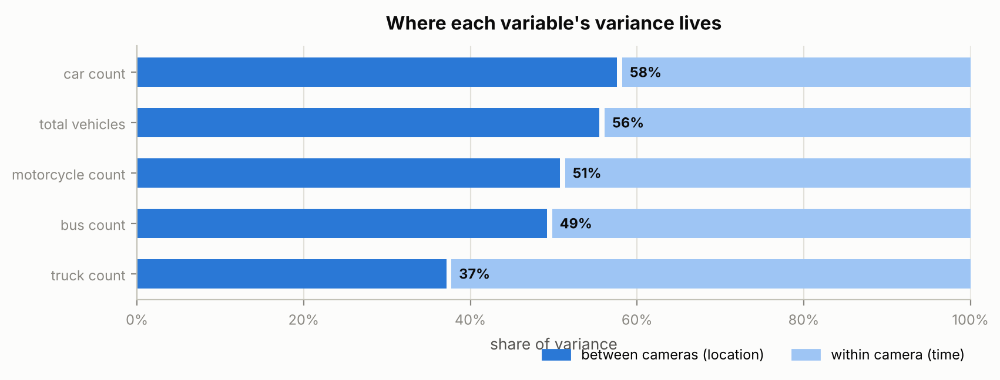

*Between-camera versus within-camera share of variance.*

*Intraclass correlation by variable (camera as the grouping).*

| variable         |      icc |   var_between |   var_within |     n |   n_groups |
|:-----------------|---------:|--------------:|-------------:|------:|-----------:|
| car_count        | 0.576029 |     14.3157   |    10.5367   | 10728 |        100 |
| total_vehicles   | 0.555039 |     22.7019   |    18.1996   | 10728 |        100 |
| motorcycle_count | 0.50751  |      1.10433  |     1.07165  | 10728 |        100 |
| bus_count        | 0.492179 |      0.174445 |     0.17999  | 10728 |        100 |
| truck_count      | 0.371293 |      0.504196 |     0.853748 | 10728 |        100 |

## 5. Spatial structure

**Finding.** Mean traffic ranges 2.6 to 24.6 vehicles per frame across cameras, a 9.3x spread. This is the dominant source of variation in the dataset.

**Finding.** Moran's I for camera-mean traffic is +0.105 (p = 0.054, k = 5, expected under spatial randomness -0.010).

**Finding.** That does not clear the 0.05 threshold, so total traffic cannot be called spatially clustered at this camera spacing. The positive sign and borderline p-value mean 'not demonstrated', not 'demonstrated absent'; with 100 cameras the test has little power.

**Finding.** Individual classes do cluster: bus_count (I = +0.25, p = 0.002), motorcycle_count (I = +0.13, p = 0.024). One reading, which this data cannot confirm, is that these classes follow fixed route structure (corridors, lanes) that is geographically organised, while car counts are set mainly by what each camera is pointed at. Testing that needs road attributes the dataset does not yet carry.

**Finding.** Practical consequence: a higher-resolution map cannot be produced by interpolating between these cameras. It has to come from per-location features (road class, POI, image content) evaluated at the target point.

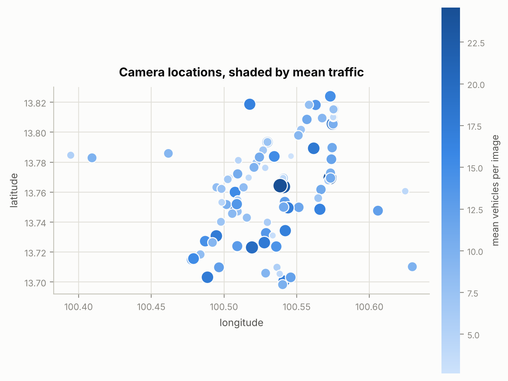

*Camera locations shaded by mean traffic.*

*Moran's I on a 5-nearest-neighbour graph, permutation p-value.*

| variable         |      I |   expected_I |     p |   n |   k |
|:-----------------|-------:|-------------:|------:|----:|----:|
| bus_count        | 0.2457 |      -0.0101 | 0.002 | 100 |   5 |
| motorcycle_count | 0.1277 |      -0.0101 | 0.024 | 100 |   5 |
| total_vehicles   | 0.1047 |      -0.0101 | 0.054 | 100 |   5 |
| car_count        | 0.0904 |      -0.0101 | 0.083 | 100 |   5 |
| truck_count      | 0.0811 |      -0.0101 | 0.126 | 100 |   5 |

*Ten busiest cameras by mean vehicles per frame.*

|   camera_id | location_en                                                | location_detail_en                          |   total_vehicles |   heavy_share |   n_images |
|------------:|:-----------------------------------------------------------|:--------------------------------------------|-----------------:|--------------:|-----------:|
|         277 | Footbridge near Soi Rang Nam on Phayathai Road             | From Victory Monument                       |           24.581 |         0.187 |        613 |
|         112 | near the police box on Thiam Ruam Mit Road                 | From Thiam Ruam Mit Road                    |           23.013 |         0.113 |        615 |
|          11 | Traffic Lights near Soi Rajavithi  6 on Rajavithi  Road    | From Victory Monument                       |           22.825 |         0.199 |        612 |
|         599 | Surasak Intersection                                       | Towards Sathon-Surasak Intersection         |           19.823 |         0.11  |        616 |
|         124 | Central barrier near the police box on Ratchadaphisek Road | From Lat Phrao                              |           19.217 |         0.113 |        612 |
|          68 | In front of bangkokbank Worachak Branch on Worachak Road   | From Worachak Intersection                  |           18.709 |         0.154 |        615 |
|        1112 | Sutthisan Intersection                                     | from Ratchada-Sutthisan intersection.       |           17.948 |         0.148 |        612 |
|         604 | Silom-Naradhiwas Intersection                              | Towards Sathon-Naradhiwas Intersection      |           17.684 |         0.139 |        614 |
|         595 | Ban Khaek Juncion                                          | IsaraPhap Road, From PhoSamTon Intersection |           17.628 |         0.109 |        611 |
|        1195 | Near the police box on Mahai Sawan Road (Inbound)          | From Charoen Nakhon Road                    |           17.573 |         0.135 |        609 |

*Ten quietest cameras by mean vehicles per frame.*

|   camera_id | location_en                                                       | location_detail_en                                                         |   total_vehicles |   heavy_share |   n_images |
|------------:|:------------------------------------------------------------------|:---------------------------------------------------------------------------|-----------------:|--------------:|-----------:|
|         371 | Thewet Intersection                                               | Towards Makkhawan Intersection                                             |            4.333 |         0.178 |        615 |
|         939 | connect BMAcctv                                                   | connect BMAcctv                                                            |            4.144 |         0.181 |        613 |
|         179 | Footbridge in front of  PHYATHAI HOSPITAL 2 on Phahon Yothin Road | From Victory Monument towards Saphan Khwai Intersection                    |            4.036 |         0.162 |        614 |
|        1362 | Nakhon Chai Si Intersection                                       | Left side towards Uphai Chetsaduthit Intersection                          |            4.005 |         0.064 |        614 |
|         206 | Footbridge near Soi Narathiwas 20 on Narathiwas Road              | From Ratchada-Naradhiwas Intersection towards Chan-Naradhiwas Intersection |            3.984 |         0.186 |        610 |
|         127 | Near Soi Lat Phrao 30 on Lat Phrao Road                           | From Ratchada-Lat Phrao Intersection towards Ratchayothin Intersection     |            3.902 |         0.2   |        614 |
|        1063 | Opposite Chitralada Palace                                        | From Wat Benchamabophit                                                    |            3.798 |         0.113 |        613 |
|         619 | Pathum Wan  Intersection                                          | Pathum Wan  Intersection                                                   |            3.326 |         0.179 |        614 |
|         370 | Thewet Intersection                                               | Towards Pracha Kasem Intersection                                          |            2.788 |         0.204 |        612 |
|         170 | Footbridge near  Nawati Somdet Ya Hospital on Phahon Yothin Road  | From Victory Monument towards Saphan Khwai Intersection                    |            2.65  |         0.082 |        614 |

## 6. Built environment against traffic

**Finding.** Of 23 POI features tested against camera-mean traffic, 2 survive Benjamini-Hochberg correction at q = 0.05.

**Finding.** Strongest surviving associations: poi_major_road_100m (rho = +0.32); poi_major_road_500m (rho = +0.29).

**Finding.** Pseudo-replication check on poi_major_road_100m: at camera level rho = +0.325, p = 9.7e-04, n = 100; at image level rho = +0.208, p < 1e-300 (underflow), n = 61,319. The coefficient barely moves, the p-value collapses by hundreds of orders of magnitude, and nothing was learned in between: the POI value is identical for every image at a given camera. 61,319 rows but only 100 independent units: a p-value computed on the rows is roughly 25x too confident.

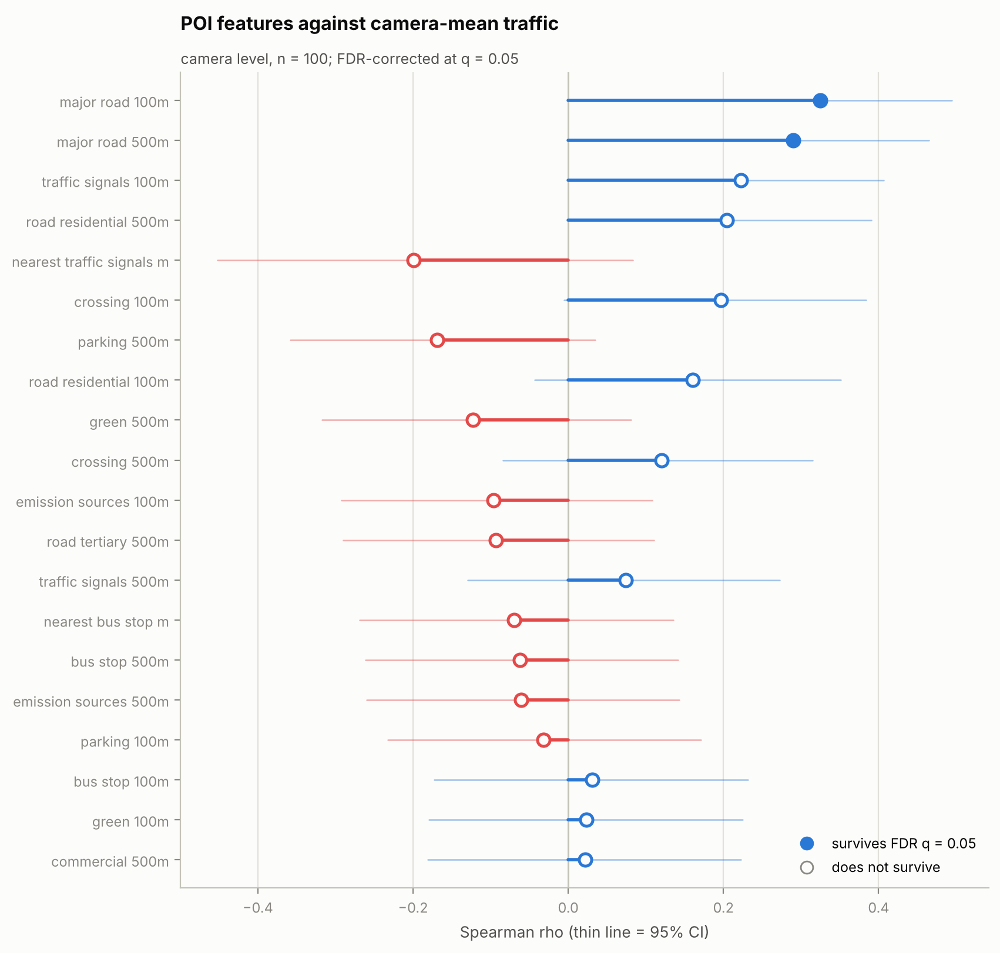

*POI features ranked by correlation with camera-mean traffic.*

*Spearman correlation of each POI feature with camera-mean traffic.*

| predictor                     |       r |   ci_low |   ci_high |      p |   p_fdr | significant   |   n | method   |   abs_r |
|:------------------------------|--------:|---------:|----------:|-------:|--------:|:--------------|----:|:---------|--------:|
| poi_major_road_100m           |  0.325  |   0.1316 |    0.4946 | 0.001  |  0.0223 | True          | 100 | spearman |  0.325  |
| poi_major_road_500m           |  0.2897 |   0.093  |    0.4645 | 0.0035 |  0.0399 | True          | 100 | spearman |  0.2897 |
| poi_traffic_signals_100m      |  0.2225 |   0.0214 |    0.4063 | 0.0261 |  0.2    | False         | 100 | spearman |  0.2225 |
| poi_road_residential_500m     |  0.2044 |   0.0024 |    0.3904 | 0.0414 |  0.2282 | False         | 100 | spearman |  0.2044 |
| poi_nearest_traffic_signals_m | -0.1993 |  -0.4522 |    0.0831 | 0.1524 |  0.4383 | False         |  53 | spearman |  0.1993 |
| poi_crossing_100m             |  0.1969 |  -0.0054 |    0.3837 | 0.0496 |  0.2282 | False         | 100 | spearman |  0.1969 |
| poi_parking_500m              | -0.1687 |  -0.3586 |    0.0345 | 0.0933 |  0.3576 | False         | 100 | spearman |  0.1687 |
| poi_road_residential_100m     |  0.1604 |  -0.0431 |    0.3511 | 0.111  |  0.3646 | False         | 100 | spearman |  0.1604 |
| poi_green_500m                | -0.1229 |  -0.3171 |    0.0812 | 0.2232 |  0.5369 | False         | 100 | spearman |  0.1229 |
| poi_crossing_500m             |  0.1202 |  -0.0839 |    0.3147 | 0.2334 |  0.5369 | False         | 100 | spearman |  0.1202 |
| poi_emission_sources_100m     | -0.0964 |  -0.2927 |    0.1078 | 0.3402 |  0.6799 | False         | 100 | spearman |  0.0964 |
| poi_road_tertiary_500m        | -0.0935 |  -0.2901 |    0.1106 | 0.3547 |  0.6799 | False         | 100 | spearman |  0.0935 |
| poi_traffic_signals_500m      |  0.0743 |  -0.1297 |    0.2723 | 0.4626 |  0.788  | False         | 100 | spearman |  0.0743 |
| poi_nearest_bus_stop_m        | -0.0695 |  -0.2688 |    0.1355 | 0.4944 |  0.788  | False         |  99 | spearman |  0.0695 |
| poi_bus_stop_500m             | -0.0623 |  -0.2611 |    0.1415 | 0.538  |  0.788  | False         | 100 | spearman |  0.0623 |
| poi_emission_sources_500m     | -0.0608 |  -0.2596 |    0.1431 | 0.5481 |  0.788  | False         | 100 | spearman |  0.0608 |
| poi_parking_100m              | -0.0322 |  -0.2327 |    0.171  | 0.7508 |  0.9547 | False         | 100 | spearman |  0.0322 |
| poi_bus_stop_100m             |  0.0307 |  -0.1724 |    0.2314 | 0.7616 |  0.9547 | False         | 100 | spearman |  0.0307 |
| poi_green_100m                |  0.0235 |  -0.1794 |    0.2245 | 0.8164 |  0.9547 | False         | 100 | spearman |  0.0235 |
| poi_commercial_500m           |  0.0217 |  -0.1811 |    0.2228 | 0.8302 |  0.9547 | False         | 100 | spearman |  0.0217 |
| poi_nearest_green_m           |  0.0167 |  -0.202  |    0.2338 | 0.8788 |  0.9625 | False         |  86 | spearman |  0.0167 |
| poi_commercial_100m           |  0.0089 |  -0.1935 |    0.2106 | 0.9302 |  0.9632 | False         | 100 | spearman |  0.0089 |
| poi_road_tertiary_100m        |  0.0047 |  -0.1976 |    0.2065 | 0.9632 |  0.9632 | False         | 100 | spearman |  0.0047 |

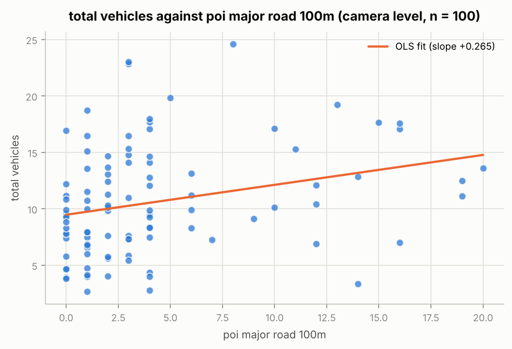

*Camera-mean traffic against poi_major_road_100m.*

*Same features against the heavy-vehicle share.*

| predictor                     |       r |   ci_low |   ci_high |      p |   p_fdr | significant   |   n | method   |   abs_r |
|:------------------------------|--------:|---------:|----------:|-------:|--------:|:--------------|----:|:---------|--------:|
| poi_nearest_green_m           |  0.3419 |   0.1339 |    0.521  | 0.0013 |  0.0293 | True          |  86 | spearman |  0.3419 |
| poi_crossing_100m             | -0.2823 |  -0.4582 |   -0.0851 | 0.0044 |  0.0396 | True          | 100 | spearman |  0.2823 |
| poi_green_100m                | -0.2776 |  -0.4542 |   -0.08   | 0.0052 |  0.0396 | True          | 100 | spearman |  0.2776 |
| poi_major_road_500m           |  0.2461 |   0.0464 |    0.4269 | 0.0136 |  0.0781 | False         | 100 | spearman |  0.2461 |
| poi_green_500m                | -0.2284 |  -0.4115 |   -0.0276 | 0.0223 |  0.1025 | False         | 100 | spearman |  0.2284 |
| poi_major_road_100m           |  0.2173 |   0.016  |    0.4018 | 0.0298 |  0.1144 | False         | 100 | spearman |  0.2173 |
| poi_nearest_traffic_signals_m |  0.1718 |  -0.1114 |    0.4291 | 0.2188 |  0.4194 | False         |  53 | spearman |  0.1718 |
| poi_traffic_signals_100m      | -0.1688 |  -0.3586 |    0.0345 | 0.0932 |  0.2826 | False         | 100 | spearman |  0.1688 |
| poi_crossing_500m             | -0.1662 |  -0.3563 |    0.0371 | 0.0983 |  0.2826 | False         | 100 | spearman |  0.1662 |
| poi_commercial_100m           | -0.16   |  -0.3508 |    0.0434 | 0.1117 |  0.2854 | False         | 100 | spearman |  0.16   |
| poi_emission_sources_100m     |  0.1282 |  -0.0759 |    0.3219 | 0.2038 |  0.4194 | False         | 100 | spearman |  0.1282 |
| poi_road_residential_500m     |  0.1265 |  -0.0775 |    0.3204 | 0.2097 |  0.4194 | False         | 100 | spearman |  0.1265 |
| poi_parking_500m              | -0.1115 |  -0.3067 |    0.0926 | 0.2693 |  0.4372 | False         | 100 | spearman |  0.1115 |
| poi_road_residential_100m     | -0.1076 |  -0.303  |    0.0966 | 0.2868 |  0.4372 | False         | 100 | spearman |  0.1076 |
| poi_road_tertiary_100m        | -0.1032 |  -0.299  |    0.101  | 0.3069 |  0.4372 | False         | 100 | spearman |  0.1032 |
| poi_commercial_500m           | -0.1026 |  -0.2985 |    0.1016 | 0.3098 |  0.4372 | False         | 100 | spearman |  0.1026 |
| poi_traffic_signals_500m      | -0.0979 |  -0.2942 |    0.1063 | 0.3324 |  0.4372 | False         | 100 | spearman |  0.0979 |
| poi_road_tertiary_500m        | -0.096  |  -0.2924 |    0.1082 | 0.3421 |  0.4372 | False         | 100 | spearman |  0.096  |
| poi_bus_stop_500m             | -0.0496 |  -0.2492 |    0.154  | 0.6241 |  0.7554 | False         | 100 | spearman |  0.0496 |
| poi_bus_stop_100m             | -0.0176 |  -0.2189 |    0.1851 | 0.8618 |  0.9684 | False         | 100 | spearman |  0.0176 |
| poi_nearest_bus_stop_m        |  0.0148 |  -0.1888 |    0.2173 | 0.8842 |  0.9684 | False         |  99 | spearman |  0.0148 |
| poi_parking_100m              | -0.0064 |  -0.2082 |    0.196  | 0.9499 |  0.9774 | False         | 100 | spearman |  0.0064 |
| poi_emission_sources_500m     | -0.0029 |  -0.2048 |    0.1993 | 0.9774 |  0.9774 | False         | 100 | spearman |  0.0029 |

## 7. Camera typology: types of place, not levels of traffic

**Finding.** Clustering the 100 cameras on the shape of their day (each profile divided by its own mean) gives 2 types, chosen by silhouette score over k = 2 to 6 (best 0.198).

**Finding.** A silhouette of 0.198 is weak. The profiles form more of a continuum than clean groups, so treat these as convenient bands along one gradient, not as discrete camera species.

**Finding.** Type 1: 59 cameras. Its average day peaks at 16:00 (1.26x the camera's own mean) and falls to 0.39x by 21:00; individual cameras in it peak at a median of 14:00 and average 9.5 vehicles per frame.

**Finding.** Type 2: 41 cameras. Its average day peaks at 17:00 (1.41x the camera's own mean) and falls to 0.74x by 21:00; individual cameras in it peak at a median of 17:00 and average 11.3 vehicles per frame.

**Finding.** Profile type correlates with how busy a camera is at rho = +0.154 (p = 0.126), so the shape of a camera's day and its traffic volume are largely independent. The typology is a genuinely new axis.

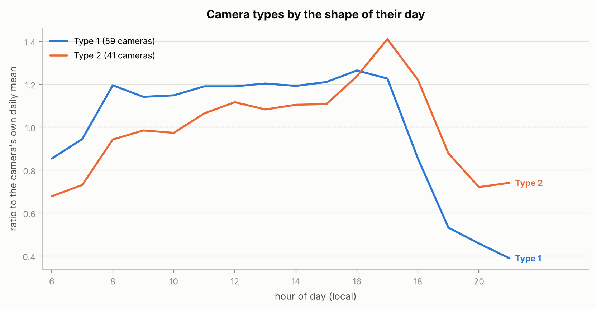

*Each camera type's day, indexed to its own mean.*

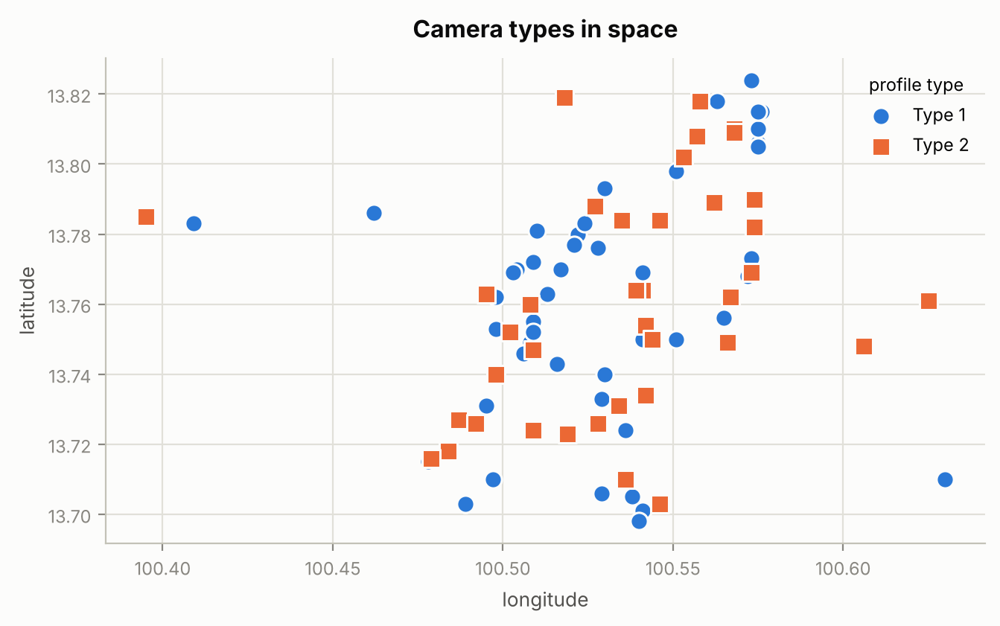

*Where each camera type sits in the city.*

*Camera types: size, timing and sharpness of peak.*

|   profile_cluster |   n_cameras |   mean_vehicles |   centroid_peak_hour |   median_peak_hour |   mean_peak_ratio |
|------------------:|------------:|----------------:|---------------------:|-------------------:|------------------:|
|                 1 |          59 |            9.54 |                   16 |                 14 |               1.5 |
|                 2 |          41 |           11.31 |                   17 |                 17 |               1.5 |

*Every camera with its assigned profile type.*

|   camera_id | location_en                                                                       |   profile_cluster |   total_vehicles |   latitude |   longitude |
|------------:|:----------------------------------------------------------------------------------|------------------:|-----------------:|-----------:|------------:|
|          11 | Traffic Lights near Soi Rajavithi  6 on Rajavithi  Road                           |                 2 |           22.825 |     13.764 |     100.541 |
|          18 | Saphan Daeng Intersection                                                         |                 1 |           14.085 |     13.793 |     100.53  |
|          26 | Near Pao Leng Pharmacy on Mahai Sawan Road (Inbound)                              |                 1 |           17.062 |     13.703 |     100.489 |
|          32 | Bang Yi Rue Intersection  on Phetkasem Road                                       |                 2 |           14.613 |     13.727 |     100.487 |
|          36 | Near the police box and BRT Ratchapruek Station on Ratchapruek Road               |                 1 |           12.85  |     13.715 |     100.478 |
|          68 | In front of bangkokbank Worachak Branch on Worachak Road                          |                 1 |           18.709 |     13.749 |     100.508 |
|          70 | Near Thanachart Bank Public Company Limited,Branch Bang Khunphrom on Sam Sen Road |                 1 |            7.47  |     13.769 |     100.503 |
|          75 | Under the overpass on Narathiwas Road                                             |                 1 |           17.111 |     13.701 |     100.541 |
|          82 | Footbridge near Soi Ratchaprarop 3 on Ratchaprarop Road                           |                 2 |           12.776 |     13.754 |     100.542 |
|          88 | Chan-Sathu Pradit Intersection Intersection                                       |                 1 |            9.476 |     13.706 |     100.529 |
|         112 | near the police box on Thiam Ruam Mit Road                                        |                 1 |           23.013 |     13.769 |     100.573 |
|         118 | Ratchada-Sutthisan Intersection                                                   |                 1 |            9.9   |     13.79  |     100.574 |
|         119 | Ratchada-Sutthisan Intersection                                                   |                 2 |           13.121 |     13.79  |     100.574 |
|         120 | Ratchada-Sutthisan Intersection                                                   |                 2 |           11.188 |     13.79  |     100.574 |
|         123 | Central barrier near the police box on Ratchadaphisek Road                        |                 1 |            6.879 |     13.805 |     100.575 |

*(85 further rows in `Component2_DataSci/output/tables/camera_profile_types.csv`)*

*Mean POI features by camera type.*

|   profile_cluster |   poi_road_tertiary_100m |   poi_road_residential_100m |   poi_traffic_signals_100m |   poi_crossing_100m |   poi_bus_stop_100m |   poi_parking_100m |   poi_green_100m |   poi_commercial_100m |   poi_major_road_100m |   poi_emission_sources_100m |   poi_road_tertiary_500m |   poi_road_residential_500m |   poi_traffic_signals_500m |   poi_crossing_500m |   poi_bus_stop_500m |   poi_parking_500m |   poi_green_500m |   poi_commercial_500m |   poi_major_road_500m |   poi_emission_sources_500m |   poi_nearest_green_m |   poi_nearest_traffic_signals_m |   poi_nearest_bus_stop_m |
|------------------:|-------------------------:|----------------------------:|---------------------------:|--------------------:|--------------------:|-------------------:|-----------------:|----------------------:|----------------------:|----------------------------:|-------------------------:|----------------------------:|---------------------------:|--------------------:|--------------------:|-------------------:|-----------------:|----------------------:|----------------------:|----------------------------:|----------------------:|--------------------------------:|-------------------------:|
|                 1 |                     0.31 |                        1.03 |                       0.56 |                4.9  |                 0.8 |               0.29 |             0.31 |                  6.44 |                  4.34 |                        0.32 |                     4.27 |                       62    |                       2.15 |               49.05 |                9.78 |               6.78 |            10.27 |                 88.61 |                 21.98 |                        3.12 |                229.92 |                          186.27 |                   110.79 |
|                 2 |                     0.54 |                        1.51 |                       0.66 |                4.98 |                 1   |               0.32 |             0.71 |                  4.88 |                  4.1  |                        0.07 |                     4.15 |                       67.63 |                       2.54 |               54.56 |                8.71 |               7.8  |            12.88 |                102.83 |                 25.17 |                        3.17 |                157.84 |                          223.47 |                    95.53 |

## 8. The weekly rhythm

**Finding.** Across this week Wednesday is the busiest day (11.53 vehicles per frame) and Sunday the quietest (8.40), a range of 3.13. With one of each weekday in the window, that ordering describes this week, not weekdays in general.

**Finding.** The sharpest single hour is 17:00, but the morning block (06:00-11:00) carries more traffic than the evening block (16:00-21:00) on every day of the week: the evening/morning ratio runs 0.75 to 1.00 and never reaches 1. The evening rush is taller but much shorter, collapsing after 18:00, so the morning window holds more total traffic. A dashboard ranking locations on a peak-hour number and one ranking them on a daily total will not agree, and both are defensible. Pick one and label it.

**Finding.** The weekend drop is not uniform across camera types: type 1 loses 21% of its weekday traffic, against 18% for the least affected type. Commuter-driven locations and all-week locations are distinguishable from the counts alone.

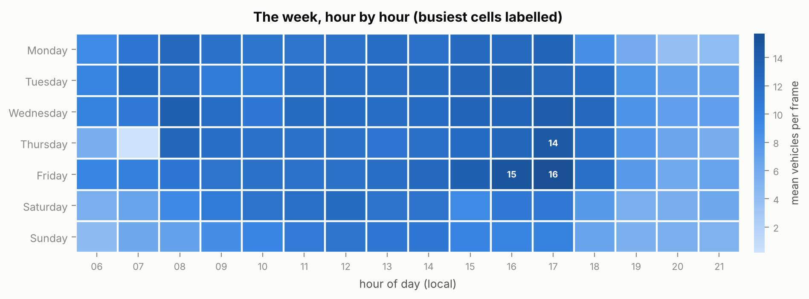

*Mean vehicles per frame by day of week and hour.*

*Day of week by hour, mean vehicles per frame.*

| day_name   |     6 |      7 |      8 |      9 |     10 |     11 |     12 |     13 |     14 |     15 |     16 |     17 |     18 |    19 |    20 |    21 |
|:-----------|------:|-------:|-------:|-------:|-------:|-------:|-------:|-------:|-------:|-------:|-------:|-------:|-------:|------:|------:|------:|
| Monday     | 9.198 | 11.228 | 12.638 | 11.806 | 11.39  | 11.522 | 11.641 | 12.18  | 11.761 | 12.528 | 12.576 | 13.162 |  8.7   | 5.985 | 3.865 | 4.205 |
| Tuesday    | 9.811 | 12.279 | 11.959 | 10.615 | 10.75  | 11.887 | 12.121 | 12.102 | 12.479 | 12.962 | 13.455 | 12.763 | 12.098 | 8.207 | 6.975 | 6.642 |
| Wednesday  | 9.914 | 10.944 | 13.685 | 12.182 | 11.048 | 12.368 | 12.278 | 12.161 | 12.273 | 13.042 | 13.156 | 14.116 | 12.713 | 8.291 | 7.277 | 7.228 |
| Thursday   | 5.667 |  0.197 | 12.838 | 12.087 | 11.751 | 11.793 | 11.809 | 11.438 | 11.985 | 12.264 | 12.86  | 14.477 | 11.77  | 7.944 | 6.528 | 5.727 |
| Friday     | 9.569 | 10.358 | 11.278 | 11.517 | 11.768 | 11.608 | 11.813 | 12.101 | 12.705 | 13.66  | 14.942 | 15.703 | 11.894 | 7.637 | 6.253 | 6.636 |
| Saturday   | 5.55  |  6.651 |  9.282 | 10.762 | 11.55  | 12.027 | 12.474 | 11.577 | 11.528 |  9.188 | 10.909 | 10.948 |  7.664 | 5.576 | 5.7   | 6.333 |
| Sunday     | 4.436 |  6.263 |  6.934 |  8.794 |  9.597 | 10.683 | 11.514 | 11.124 | 11.093 |  9.715 |  9.81  |  9.919 |  6.673 | 5.492 | 5.57  | 5.22  |

*How much each camera type loses at the weekend.*

|   profile_cluster |   weekday |   weekend |   weekend_drop_pct |
|------------------:|----------:|----------:|-------------------:|
|                 1 |    10.379 |     8.191 |               21.1 |
|                 2 |    12.059 |     9.835 |               18.4 |

## 9. Anomalies: where the data stops behaving

**Finding.** Before any anomaly scoring: 519 camera-hours are built from under half the usual number of images. Of these, hour 21:00 is short on every date, so that is the edge of the collection window rather than a fault. Any hourly average must drop that hour or it will report a phantom evening collapse.

**Finding.** The remaining 165 gaps are a genuine outage, not a window edge: 165 of them fall on 2026-08-27 alone, in hours 07:00, 08:00. The scraper missed that morning. Exclude those camera-hours from any model or dashboard average, or that morning reads as empty roads across the whole city.

**Finding.** A further 472 camera-hours produced no row at all, because no image was captured. 2026-08-27 is the thinnest date with 1,429 camera-hours against a median of 1,550. Absent rows are the easy mistake here: a groupby over what is present silently averages over a smaller city rather than reporting a gap.

**Finding.** All of these camera-hours are excluded from the scoring below.

**Finding.** Of the 10,209 camera-hours that remain, 317 (3.11%) deviate from what that camera normally does at that hour on that type of day by more than 3.5 robust standard deviations, against well under 0.1% under a normal model.

**Finding.** The expectation is conditioned on weekday against weekend as well as on hour. Keyed on hour alone it flagged most of Saturday and Sunday, which is the weekend rather than an event.

**Finding.** That is not an artefact of a collapsed scale: the median robust standard deviation is 1.48 vehicles, about 14% of the overall mean, and the residual distribution has an excess kurtosis of 4.6 against 0 for a normal. The counts genuinely have heavy tails, so these flags are structure: incidents, closures, weather, or detector failures.

**Finding.** 56% of the flags are surges and 44% are drops. Drops are the more useful signal operationally: a camera that suddenly sees nothing is usually a blocked view or a failed detection, not an empty road.

**Finding.** Flags are concentrated, not spread evenly: camera 196 alone accounts for 14 of them. Check that camera's imagery before treating its numbers as traffic.

**Finding.** Separately, the five cameras with the flattest counts (coefficient of variation 0.20 to 0.26) are worth a manual look. A traffic camera whose count barely moves across a week is more likely mis-framed or obstructed than genuinely steady.

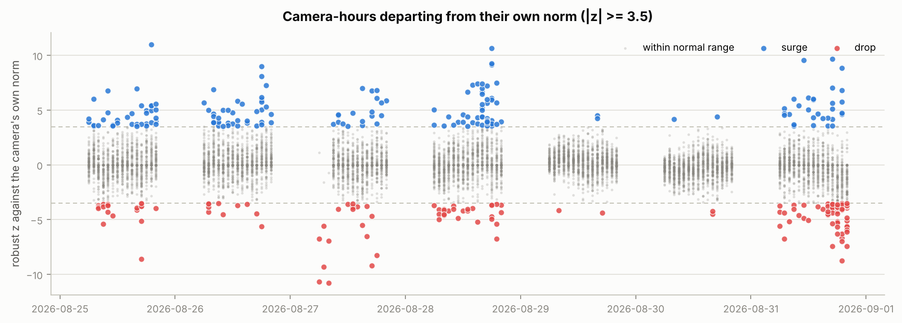

*Every scored camera-hour by its deviation from that camera's own norm for that hour and day type.*

*Collection gaps: camera-hours built from under half the usual number of images. Excluded from scoring.*

|                    |   camera_hours |   mean_coverage |
|:-------------------|---------------:|----------------:|
| ('2026-08-27', 8)  |             96 |           0.167 |
| ('2026-08-27', 7)  |             69 |           0.167 |
| ('2026-08-26', 21) |             57 |           0.167 |
| ('2026-08-27', 21) |             55 |           0.167 |
| ('2026-08-25', 21) |             53 |           0.167 |
| ('2026-08-29', 21) |             51 |           0.167 |
| ('2026-08-30', 21) |             50 |           0.167 |
| ('2026-08-28', 21) |             44 |           0.167 |
| ('2026-08-31', 21) |             44 |           0.167 |

*The most extreme camera-hours.*

|   camera_id | hourly_timestamp    | day_name   |   hour |   total_vehicles |   expected |       z | direction   |
|------------:|:--------------------|:-----------|-------:|-----------------:|-----------:|--------:|:------------|
|         196 | 2026-08-25 19:00:00 | Tuesday    |     19 |           14.833 |      7.5   |  10.992 | surge       |
|         432 | 2026-08-27 08:00:00 | Thursday   |      8 |            1.833 |     15.167 | -10.792 | drop        |
|         432 | 2026-08-27 06:00:00 | Thursday   |      6 |            0     |     13.2   | -10.684 | drop        |
|         233 | 2026-08-28 18:00:00 | Friday     |     18 |           13.833 |      3.333 |  10.623 | surge       |
|         170 | 2026-08-31 17:00:00 | Monday     |     17 |           12.5   |      5.333 |   9.668 | surge       |
|         224 | 2026-08-31 11:00:00 | Monday     |     11 |           27     |     11.667 |   9.547 | surge       |
|         432 | 2026-08-27 07:00:00 | Thursday   |      7 |            0     |     11.5   |  -9.308 | drop        |
|        1070 | 2026-08-28 18:00:00 | Friday     |     18 |           25.5   |     14.667 |   9.23  | surge       |
|         141 | 2026-08-27 17:00:00 | Thursday   |     17 |           19.833 |     26.667 |  -9.218 | drop        |
|         224 | 2026-08-28 18:00:00 | Friday     |     18 |           24.5   |      9.833 |   9.132 | surge       |
|         141 | 2026-08-26 18:00:00 | Wednesday  |     18 |           29.167 |     22.5   |   8.993 | surge       |
|         224 | 2026-08-31 19:00:00 | Monday     |     19 |           20.667 |      6.5   |   8.82  | surge       |
|         141 | 2026-08-31 19:00:00 | Monday     |     19 |            4.5   |     11     |  -8.768 | drop        |
|         630 | 2026-08-25 17:00:00 | Tuesday    |     17 |            8     |     16.5   |  -8.6   | drop        |
|         176 | 2026-08-27 18:00:00 | Thursday   |     18 |            7     |     14.667 |  -8.274 | drop        |
|         137 | 2026-08-26 18:00:00 | Wednesday  |     18 |           19.167 |      9.167 |   8.094 | surge       |
|         224 | 2026-08-28 19:00:00 | Friday     |     19 |           18.5   |      6.5   |   7.471 | surge       |
|         556 | 2026-08-28 15:00:00 | Friday     |     15 |           14.333 |      5.167 |   7.419 | surge       |
|         211 | 2026-08-31 20:00:00 | Monday     |     20 |            4.667 |     17.5   |  -7.419 | drop        |
|         556 | 2026-08-28 16:00:00 | Friday     |     16 |           15.667 |      6.5   |   7.419 | surge       |

*(30 further rows in `Component2_DataSci/output/tables/top_anomalies.csv`)*

*Cameras producing the most flags.*

|   camera_id |   n_flagged_hours |
|------------:|------------------:|
|         196 |                14 |
|         141 |                11 |
|         224 |                11 |
|         395 |                11 |
|         630 |                10 |
|        1070 |                 9 |
|         301 |                 9 |
|         233 |                 8 |
|          82 |                 8 |
|         170 |                 7 |
|         139 |                 7 |
|         211 |                 7 |
|         619 |                 6 |
|         556 |                 6 |
|          26 |                 6 |

*Cameras whose counts barely move; check these manually.*

|   camera_id |   mean |   std |    cv |
|------------:|-------:|------:|------:|
|          32 | 14.531 | 2.986 | 0.205 |
|         604 | 17.7   | 4.144 | 0.234 |
|         277 | 24.334 | 5.768 | 0.237 |
|         112 | 22.875 | 5.854 | 0.256 |
|         599 | 19.496 | 5.005 | 0.257 |

## 10. Extension: PM2.5 against traffic

**Finding.** SKIPPED: pm25 is not in the prepared dataset. Run DE/main.py with OPENAQ_API_KEY set to produce data/processed/data.csv, then re-run this module; this section then executes with no code changes.

## 11. The confounding any PM2.5 model has to beat

**Finding.** Traffic's daily swing is 68% of its mean. Bangkok PM2.5 has a daily cycle of its own, so when the target arrives, expect a raw traffic-PM2.5 correlation that is substantially confounded by hour of day. The partial-correlation path in section_pm25 is already wired to handle it.

**Finding.** Standing recommendation: report the partial correlation controlling for hour of day and weather, and validate any model by splitting on whole days and whole cameras. A random row split leaks, because two images 11 minutes apart at the same camera are nearly the same observation.

*Hourly mean profiles.*

|   hour |   traffic |
|-------:|----------:|
|      6 |     8.068 |
|      7 |     8.611 |
|      8 |    11.228 |
|      9 |    11.109 |
|     10 |    11.122 |
|     11 |    11.698 |
|     12 |    11.95  |
|     13 |    11.812 |
|     14 |    11.975 |
|     15 |    11.908 |
|     16 |    12.53  |
|     17 |    13.013 |
|     18 |    10.216 |
|     19 |     7.019 |
|     20 |     6.024 |
|     21 |     6.045 |

## 12. Handoff to Component 3 (dashboard)

Component 3 needs tidy tables, not this report. These are written to `Component2_DataSci/output/dashboard/` on every run, so the dashboard reads files rather than re-deriving the analysis:

| file                                                  |   rows |   columns | grain                                                                 |
|:------------------------------------------------------|-------:|----------:|:----------------------------------------------------------------------|
| Component2_DataSci/output/dashboard/cameras.csv       |    100 |        39 | one row per camera: location, profile type, mean counts, POI features |
| Component2_DataSci/output/dashboard/camera_hours.csv  |  10728 |        16 | one row per camera-hour: counts, expected value, deviation score      |
| Component2_DataSci/output/dashboard/anomaly_flags.csv |    317 |        17 | one row per flagged camera-hour                                       |

## 13. Component 4: the outcome of the analysis

- **Location dominates time.** 56% of camera-hour traffic variance is between cameras and only 44% within them. Feature engineering effort belongs on per-location descriptors; hour-of-day is a correction term, not a driver.
- **Aggregate before modelling.** The four detector channels correlate at a mean rho of +0.21 per frame but +0.39 per camera, so per-frame counts are mostly detector noise. The camera-hour mean is the smallest unit that measures anything stable.
- **Split on cameras and whole days when validating.** Two images 11 minutes apart at one camera are nearly the same observation, so a random row split will report an accuracy the model does not have.
- **Do not correlate camera-constant features against image rows.** The strongest POI association carries p = 0.00097 at camera level and under 1e-300 at image level, on essentially the same coefficient. Repeating one camera's POI value across its 613 images adds no information and inflates significance. Every number in the final report should name the level it was computed at.
- **Spatial clustering is weak and class-specific.** Total traffic does not clear the test (I = +0.10, p = 0.054); only bus_count and motorcycle_count do, and at I below 0.25. A map cannot be made by interpolating between cameras: it has to be predicted at each point from that point's own features.
- **The built environment explains traffic only weakly, and only through road class.** 2 of 23 POI features survive FDR correction, led by poi_major_road_100m at rho = +0.33 (about 11% of variance). Amenity categories - shops, offices, bus stops, green space - carry nothing. If more location signal is needed, it should come from road geometry (lane count, carriageway width, junction type), not from more POI categories.
- **The hypothesis is untested until `data/processed/data.csv` exists.** Every PM2.5 result in section 7 is wired and will run unchanged once the air-quality and weather columns are present; the analysis is blocked on data, not on code.
- **Camera behaviour is a continuum, not a set of types.** The best clustering of daily profiles is k = 2 at a silhouette of only 0.20, with the groups peaking at 16:00, 17:00. Cameras differ mainly in when their peak falls, along one gradient. The split is still usable as a coarse dashboard filter, but the report should not call these distinct camera species, and a model should prefer the continuous peak-hour value over a cluster label.
- **Peak-hour and daily-total rankings disagree.** The sharpest hour of the day is the evening rush, but it collapses after 18:00, so the morning block carries more total traffic on every day of this week. Wednesday is the busiest day against Sunday as the quietest. Whichever measure the dashboard ranks on, label it, because the two orders are different.
- **3.11% of camera-hours do not behave like themselves.** 317 camera-hours deviate from that camera's own median for that hour by more than 3.5 robust standard deviations, far above what noise would produce, and the flags are concentrated in a few cameras. Some are real events and some are detector failures; separating the two needs a look at the underlying images, which is the single highest-value next step for the group.

## Reproducing this

`python Component2_DataSci/main.py` from the repository root. It reads `data/processed/data.csv` when that exists and falls back to `Carcounts.csv` plus `camera_poi.csv` otherwise, so it runs in both states of the pipeline. Statistical primitives are in `Component2_DataSci/stats_tools.py`, feature engineering in `Component2_DataSci/features.py`, the sections in `Component2_DataSci/analysis.py` and the plotting in `Component2_DataSci/figures.py`; nothing is hard-coded to a particular run.
